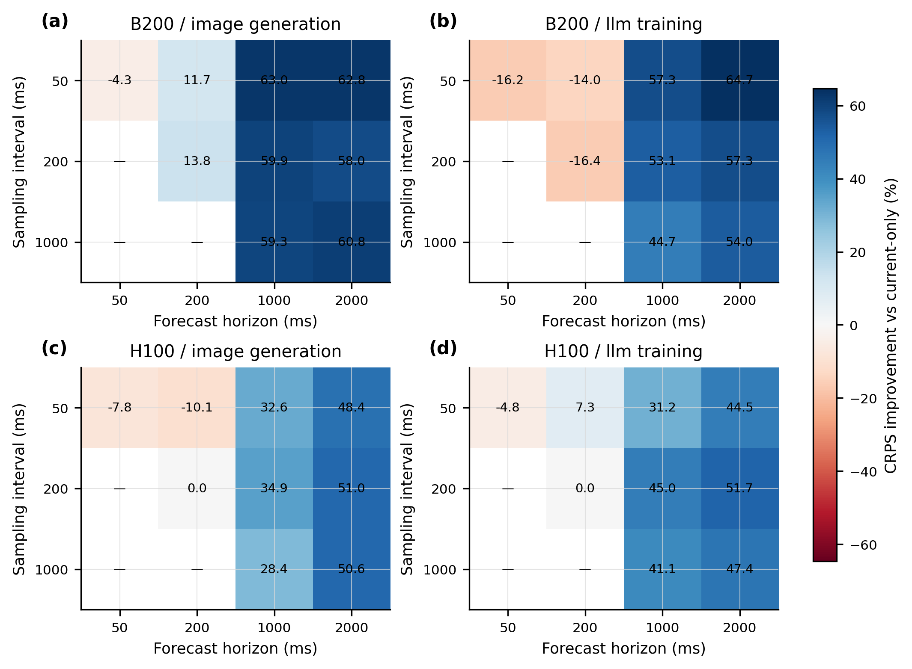
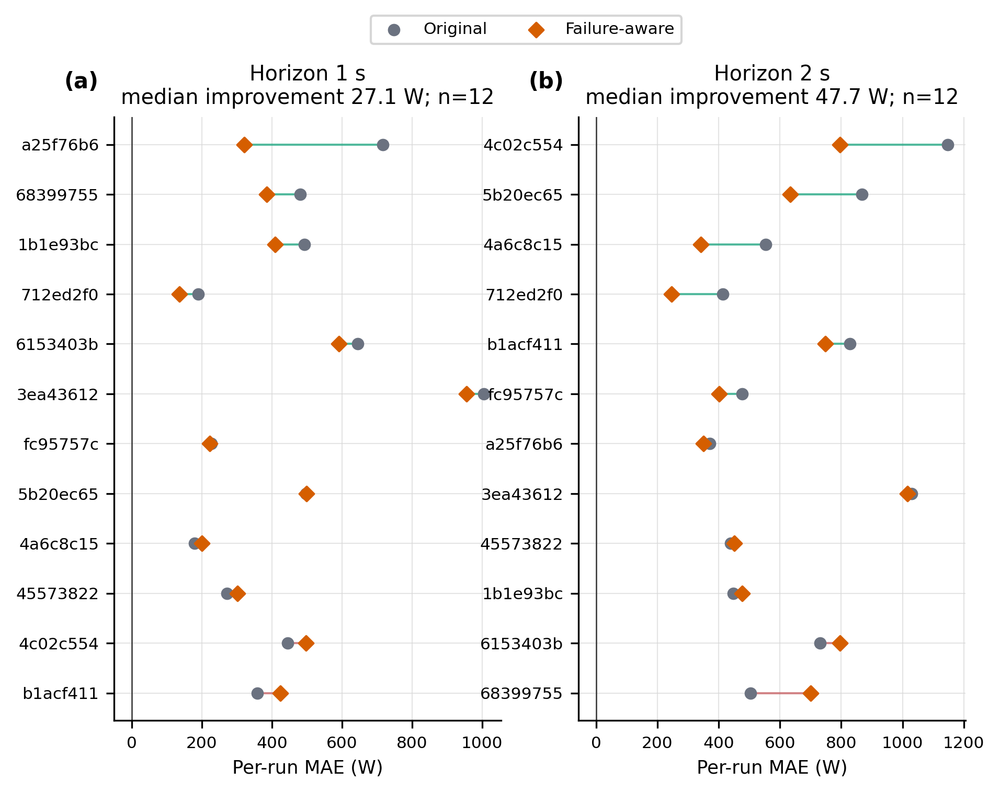
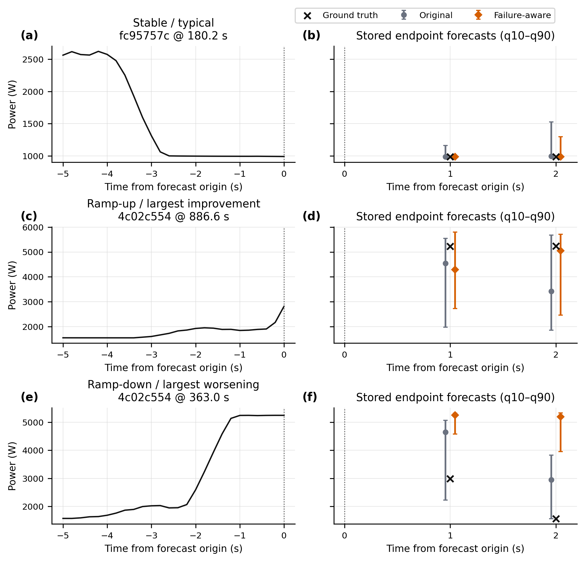
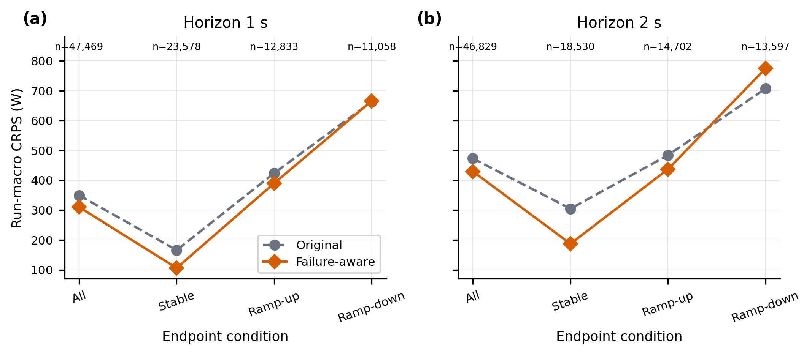
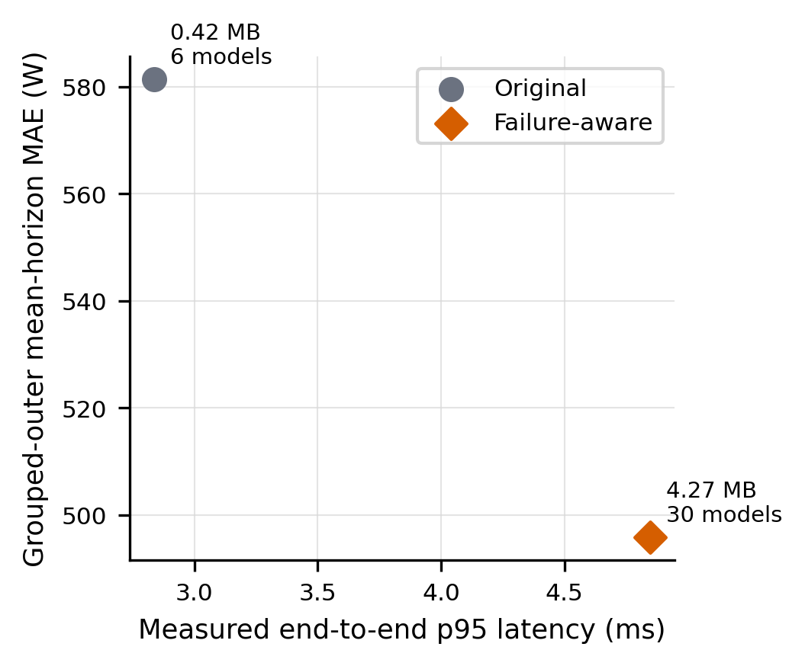

# Appendix visual index

## Table A1. Evaluation Settings

[Markdown](tables/table_A1_evaluation_settings.md) · [CSV](tables/table_A1_evaluation_settings.csv) · [LaTeX](tables/table_A1_evaluation_settings.tex)

Caption: RAFT Table 6의 조건 정렬 원칙을 전력 예측 데이터에 맞게 적용했다. Predictability의 within-run test와 failure-aware의 grouped outer/reused holdout을 분리했고, 최종 bin 간격과 원시 약 20 ms 기록 간격을 구분했다.

관측: Predictability는 50/200/1000 ms 해상도에서 9개 유효 grid cell을 평가한다. Failure-aware는 200 ms bin에서 1 s와 2 s endpoint를 평가하며 선택된 lookback은 각각 1 s와 5 s이다.

## Table A2. Full Forecasting Results

- Predictability: [CRPS](tables/table_A2a_predictability_crps.md), [MAE](tables/table_A2b_predictability_mae.md), [RMSE](tables/table_A2c_predictability_rmse.md)
- Original vs failure-aware: [CRPS](tables/table_A2d_failure_aware_crps.md), [MAE](tables/table_A2e_failure_aware_mae.md), [RMSE](tables/table_A2f_failure_aware_rmse.md)

Caption: 모든 표는 run별 metric을 먼저 구한 run-macro 결과이며 낮을수록 좋다. Predictability Avg는 9개 grid cell, failure-aware Avg는 protocol별 두 horizon 평균이다.

관측: Grouped outer에서 failure-aware CRPS 감소율은 1 s 11.3%, 2 s 9.2%이다. Reused holdout은 이미 확인된 run이므로 fresh confirmation으로 해석하지 않는다.

## Table A3. Component / Sensitivity Analysis

[Input components](tables/table_A3a_component_ablation.md) · [Resolution](tables/table_A3b_resolution_sensitivity.md) · [Selection procedure](tables/table_A3c_selection_procedure.md)

Caption: 한 표에서 하나의 주 비교축만 바꿨다. Resolution 표는 binning에 따라 target이 달라질 수 있고, selection 표는 2 s에서 후보 자체가 달라지므로 순수 단일-component ablation이 아니다.

관측: 긴 horizon에서는 History가 Current only보다 대체로 강하지만, 가장 짧은 50 ms/50 ms 조건에서는 cohort에 따라 history가 악화된다. Failure-aware 1 s의 mean-CRPS와 reliability 절차는 같은 후보를 선택했다.

## Table A4. Transition-Conditioned Performance

[Markdown](tables/table_A4_transition_conditioned.md) · [CSV](tables/table_A4_transition_conditioned.csv) · [LaTeX](tables/table_A4_transition_conditioned.tex)

Caption: All/Stable/Ramp-up/Ramp-down의 CRPS와 forecast-window 수를 함께 제시한다. Ramp는 100 W endpoint 변화 기준이며 event detection precision/recall이 아니다.

관측: 급변 조건의 CRPS는 stable보다 크다. Failure-aware 개선은 전체 평균뿐 아니라 다수 ramp 조건에서도 유지되지만, 조건별 표본 수와 오차 규모가 크게 다르다.

## Table A5. Computational Cost

[Markdown](tables/table_A5_computational_cost.md) · [CSV](tables/table_A5_computational_cost.csv) · [LaTeX](tables/table_A5_computational_cost.tex)

Caption: 동일 CPU 환경의 warm single-row benchmark다. 원 모델은 6개, failure-aware는 30개 quantile model을 실행하므로 accuracy와 함께 representation 차이를 표시했다.

관측: Failure-aware package는 MAE를 낮추는 대신 p95 end-to-end latency가 2.84 ms에서 4.85 ms로 증가한다. 이 benchmark만으로 실시간 제어 가능성을 판단할 수 없다.

## Figure A1. Resolution × Horizon Improvement Heatmap

[PDF](figures/figure_A1_resolution_horizon_heatmap.pdf) · [Plot data](plot_data/figure_A1_heatmap.csv)

Caption: History의 Current-only 대비 run-macro CRPS 개선율(%). 양수는 개선, 음수는 악화이며 미실험 cell은 회색 —로 표시했다.

관측: 가장 큰 cohort-level 개선은 B200__llm_training, 50 ms/2000 ms에서 64.7%다. 짧은 horizon에서는 history feature가 항상 이득이 아니다.

## Figure A2. Paired Per-Run Comparison

[PDF](figures/figure_A2_paired_per_run.pdf) · [Plot data](plot_data/figure_A2_paired_runs.csv)

Caption: Grouped-outer, seed 42, history+metadata/full15의 run별 MAE paired dot plot. 초록 연결선은 개선, 적색은 악화이며 horizon을 섞지 않았다.

관측: 두 horizon을 합친 24 paired run 중 9개에서 failure-aware MAE가 악화됐다. 평균 개선은 모든 run의 일관된 개선을 뜻하지 않는다.

## Figure A3. Multi-Panel Forecast Cases

[PDF](figures/figure_A3_forecast_cases.pdf) · [Selected cases](plot_data/figure_A3_selected_cases.csv) · [Plot data](plot_data/figure_A3_case_plot_data.csv)

Caption: 각 행 왼쪽은 실제 5 s history, 오른쪽은 저장된 1 s/2 s endpoint 예측과 q10–q90이다. 미래 trajectory는 생성하지 않았고 deterministic rule로 stable typical, ramp-up success, ramp-down failure를 선택했다.

관측: `stable` / typical: `highres_node-66fd092cfc95757c` at 180.2 s; `rising` / largest improvement: `highres_node-6cf954584c02c554` at 886.6 s; `falling` / largest worsening: `highres_node-6cf954584c02c554` at 363.0 s. 급변 사례에서 개선 폭이 클 수 있지만 반대로 baseline보다 나빠지는 실제 사례도 존재한다.

## Figure A4. Overall vs Transition Performance

[PDF](figures/figure_A4_overall_vs_transition.pdf) · [Plot data](plot_data/transition_conditioned_performance.csv)

Caption: Grouped-outer CRPS를 All/Stable/Ramp-up/Ramp-down으로 나누고 실제 window 수를 표시했다. error bar는 시계열 row를 독립 표본으로 오인할 수 있어 넣지 않았다.

관측: Ramp-up/down CRPS가 stable보다 높아 전체 평균만으로 실패 상황을 설명하기 어렵다. 2 s는 1 s보다 전반적으로 어려운 조건이다.

## Figure A5. Accuracy–Cost Trade-off

[PDF](figures/figure_A5_accuracy_cost.pdf) · [Plot data](plot_data/accuracy_cost.csv)

Caption: 실제 deployment package의 p95 end-to-end latency와 grouped-outer 두-horizon 평균 MAE. quantile model 수와 package 크기를 점 옆에 표시했다.

관측: Failure-aware는 accuracy를 개선하지만 계산량과 package 크기를 늘린다. 두 점만으로 Pareto frontier나 운영 적합성을 주장하지 않는다.
